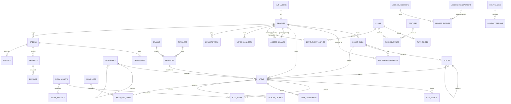

# drobie database: Step 2 foundation

The MVP database, built on the platform seams in `PLATFORM_ARCHITECTURE.md` (households, one media system, plans as data, a double-entry ledger, access grants, an outbox, currencies). 64 tables: 51 client-facing in `public` (all under RLS), 12 internal in `private`, plus `audit.log`. Only "Now" and "Seam" tables exist. "Later" tables arrive with additive migrations.

## Run it

| With Docker (normal) | Without Docker (CI fallback, any Postgres 15+) |
| --- | --- |
| `supabase start` → `supabase db reset` → `supabase test db` | `PGUSER=postgres scripts/db/test-local.sh` |
| | needs pgvector, pgmq, pg_cron (preloaded), pgTAP installed in the server |

`scripts/db/test-local.sh` rebuilds a throwaway database from the migrations and seed, runs every pgTAP file, then runs `scripts/db/concurrency-test.sh` (parallel connections). `scripts/db/explain-hot-paths.sh` loads about 100k items and prints the query plans for the hot paths.

Local test users (password `drobie-local-123`): `alice@drobie.test` (Ultimate, 200 items, two homes), `bob@drobie.test` (Free, 10 items), `carol@drobie.test` (viewer in Alice's household).

## Migrations

| File | Contents |
| --- | --- |
| `0100_foundation` | extensions, schemas, privilege defaults, `uuid_v7()`, enums, shared triggers, monthly partition helpers, outbox (`private.domain_events`, `emit`, `dispatch_events`, pgmq queues) |
| `0200_identity_households_access` | countries, profiles, consents, device_tokens, admin_users, households, household_members, places (tree ≤ 6), tags, access_grants, body_profiles, RLS helpers |
| `0300_media_taxonomy_catalog` | JSON-Schema validator, media_assets, media_variants, categories (+ attribute_schema), category_translations, brands, retailers, products |
| `0400_closet` | items, item_events (auto history), item_media, item_embeddings (HNSW), wear_logs, wear_log_items (counters by trigger), beauty_details |
| `0500_plans_entitlements` | plans, plan_prices, features, plan_features, entitlement_grants, usage_counters, `entitlement()`, `consume_quota()`, item-limit trigger, subscriptions, experiments, offers, promo codes, referrals |
| `0600_money_ledger` | tax_rates, orders, order_lines, payments, refunds, invoices (FY numbering), private ledger (accounts, transactions, entries), wallets, credits helpers |
| `0700_notifications_config_ops` | audit.log, notifications (partitioned), notification_preferences, versioned config (`config_keys`, `config_versions`, publish/approve/rollback/bundle), webhook_events, idempotency_keys, rate_limits, ai_usage (partitioned), deletion_requests, data_exports, synonyms, unmapped_terms, audit triggers, pg_cron jobs |
| `0800_signup_account` | signup bootstrap trigger, `confirm_adult()`, `is_active_adult()` |
| `0900_rls_and_grants` | privileges and every RLS policy |

## Core ERD

Future tables connect without changing these: `circles`/`connections` → `access_grants.grantee_circle_id`; `organizations` → `access_grants.grantee_org_id`, `media_assets.owner_org_id`, `orders.seller_org_id`; `bookings` → `access_grants.booking_id`; `looks` → `wear_logs.look_id`; `tag_batches` → `tags.batch_id`.

## Security model

- **Default deny.** RLS is on for every public table. All client privileges were revoked and then granted per table and per column.
- **Functions are locked too.** No function is executable by PUBLIC. A schema test pins the exact list a signed-in client can execute (RLS helpers + 3 RPCs: `entitlement`, `my_wallets`, `confirm_adult`). anon can execute nothing.
- **Protected columns** are covered by column grants plus `tg_immutable_columns`: owner columns, status, adult confirmation, inbound token, wear counters, etc. Tests prove each one is refused.
- **18+ and active status** are checked in every closet write policy (`is_active_adult`).
- **Sensitive data** (`body_profiles`) needs the measurements consent. Only a grant scoped `measurements_read` can read it. Audit rows are redacted.
- **Sharing** goes through `access_grants`. Scopes imply narrower ones (closet_read ⇒ item_read, places_read). A grant can be item-, category- or place-scoped (place grants cover sub-places). Grants can only be shortened or revoked; support grants must expire and need a support-role staff member with MFA.
- **Server-only tables** (RLS on, no client policy): plan_prices, tax_rates, experiments, offers, promo_codes, config_keys, config_versions, and everything in `private` and `audit`.

### Policies per table

| Table | Who can do what |
| --- | --- |
| profiles | own row: read, update safe columns |
| consents | own: read, append (source app/web) |
| device_tokens, notification_preferences | own: full |
| households | members read; owner renames |
| household_members | members read |
| places | members read; adult+ members create/edit; grantees with places_read read |
| items | owner full (no hard delete); household members read non-private; grantees read by scope/resource |
| item_events | owner + anyone who can read the item |
| item_media, beauty_details | read if item readable; write if item owned |
| item_embeddings, wear_logs, wear_log_items | owner only |
| media_assets, media_variants | owner, or non-sensitive media of a readable item |
| access_grants | grantor and grantee read; grantor creates/shortens/revokes |
| body_profiles | owner with consent; measurements_read grantees read |
| entitlement_grants, usage_counters, subscriptions, experiment_assignments, promo_redemptions | own: read |
| referrals | referrer or referred: read |
| orders, order_lines, payments, refunds, invoices | buyer: read |
| notifications | own: read, mark read |
| deletion_requests, data_exports | own: read |
| admin_users | own rows: read (so the app knows staff status) |
| categories, category_translations, countries, plans, features, plan_features | everyone incl. anon: read |
| brands, retailers, products, synonyms | signed-in: read |

## Server function API (what Edge Functions call)

| Function | Use |
| --- | --- |
| `private.entitlement(user, feature_key)` → jsonb | the single plan check: `{enabled, limit, period, used, remaining, plan}` |
| `private.consume_quota(user, key, amount)` / `release_quota` | atomic quota use; returns `{ok:false, reason:'quota_exceeded'}` cleanly at the limit |
| `private.post_ledger_transaction(kind, entries, idempotency_key, …)` | the only way to write money; balanced per currency; wallets never negative |
| `private.grant_credits` / `spend_credits` | Studio credits on the ledger |
| `private.issue_invoice(order)` | GST invoice number `DL/2026-27/000001` |
| `private.config_value(ns, key, locale)` / `config_bundle(locale)` | config in force / client bundle (version = ETag) |
| `private.config_approve` / `config_publish` / `config_rollback` | four-eyes, scheduled windows, one-call rollback |
| `private.emit(type, aggregate, id, payload)` | outbox event in the caller's transaction |
| `private.rate_limit_take(bucket, capacity, refill/s, cost)` | token bucket |
| `private.ai_spend_today(user?)` | budget checks in `ai-provider` |
| `private.assign_variant(experiment, user)` | sticky experiment assignment |

Client RPCs: `entitlement(feature_key)`, `my_wallets()`, `confirm_adult()`, and the view `user_entitlements`.

## Performance (≈100k items, 100 users, through RLS as a signed-in user)

| Hot path | Plan | Time |
| --- | --- | --- |
| Closet delta sync, keyset 100 rows | index `items_owner_sync_idx` | 0.3 ms |
| "Where is my black kurta" (FTS) | owner index + tsvector | 0.7 ms |
| Laundry hub counts by state | `items_owner_state_idx` | 0.2 ms |
| Entitlement check | function | ~5 ms |
| Unfiltered `select * from items` (client forgot owner filter) | seq scan + cheap policy | 38 ms |

**Rule for app and function code:** always filter list reads by `owner_user_id` (or `household_id`) explicitly. RLS is the safety net, not the query plan. Grant checks in list policies are set-based helpers that run once per statement. The first version used a per-row `has_access()` call, which took sync to 2.4 s on the same data.

## Adding a table (checklist)

1. New migration `YYYYMMDDHHMMSS_name.sql`; uuid_v7 id, `created_at`, `updated_at` + trigger, owner column defaulting to `auth.uid()` if user-owned.
2. Indexes on every FK (a schema test fails otherwise) and every policy/filter column.
3. `enable row level security`, explicit grants (table and column), policies using the helpers with `(select …)` wrapping.
4. Any new function: `set search_path = ''`, and `grant execute` only to the roles that need it. Update the allow-list test if a client must call it.
5. New extension? Grant EXECUTE on its functions explicitly, because PUBLIC no longer gets it by default.
6. pgTAP: one allowed and one denied access per role/relationship; run `scripts/db/test-local.sh`.
